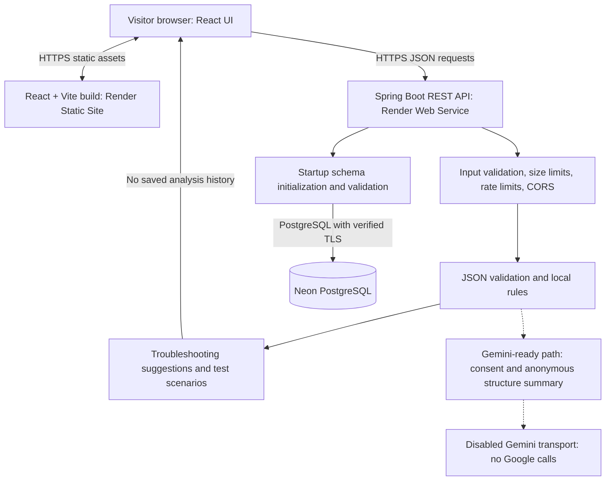
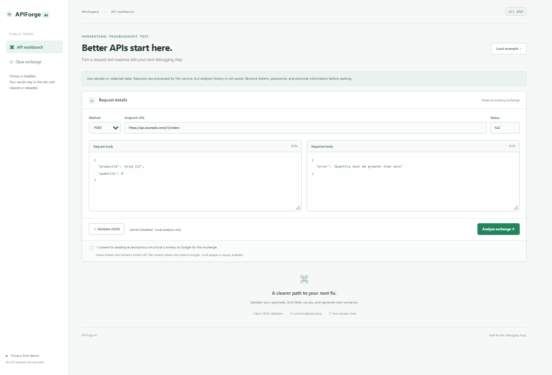
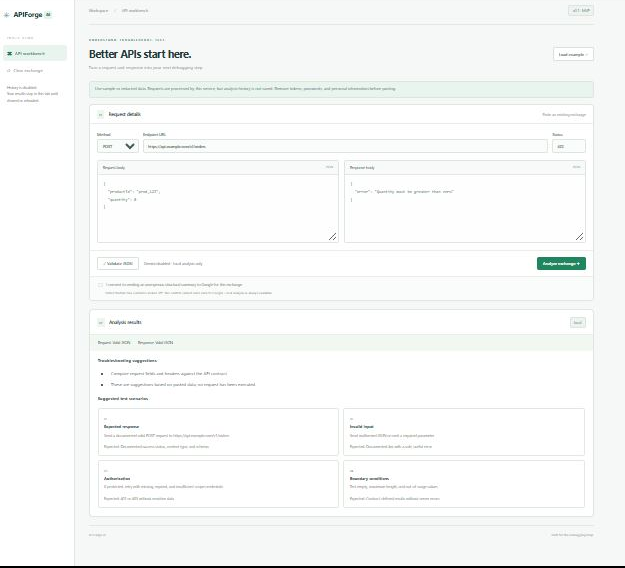
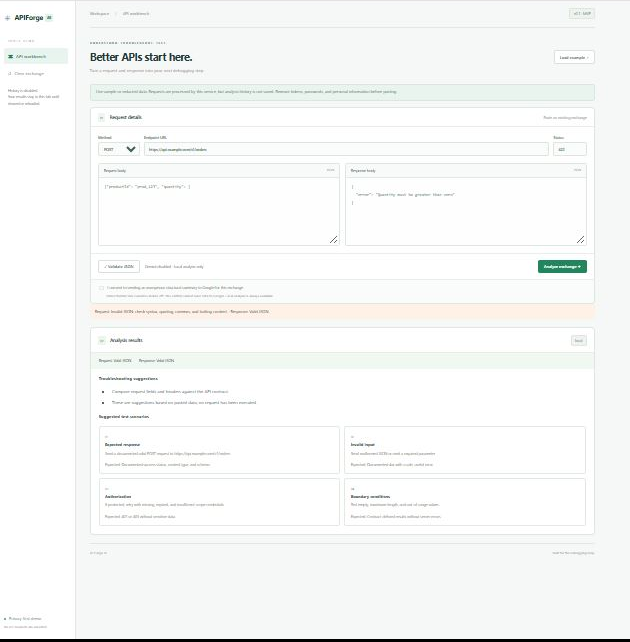

# APIForge AI

**A REST API troubleshooting workbench built with Java 21, Spring Boot, and React.**

Paste a redacted API request and response, validate JSON, inspect likely causes of HTTP errors,
and generate suggested test scenarios. APIForge AI brings backend validation, a React interface,
PostgreSQL schema management, automated tests, and security controls into one portfolio project.

[**Live Demo**](https://apiforge-ai-frontend.onrender.com/) ·
[**Backend Health**](https://apiforge-ai-backend.onrender.com/api/health) ·
[**GitHub Repository — private**](https://github.com/fathimat/apiforge-ai)

> **Current functionality:** troubleshooting suggestions and test scenarios are **rules-based**.
> Live generative AI is **not enabled**. The Gemini-ready consent interface and backend safeguards
> are merged into `main` through [PR #12](https://github.com/fathimat/apiforge-ai/pull/12)
> (merge commit `2ff0e0f`) and deployed on Render. The consent control remains disabled,
> and no live Google Gemini API calls are made.

The live demo is publicly accessible; repository access requires authorization.
The free backend may need time to wake after inactivity—wait briefly and retry if necessary.

## Explore the project

[Features](#key-features) · [Architecture](#architecture) · [Screenshots](#application-screenshots) ·
[REST API](#rest-api) · [Security](#security-privacy-and-stateless-design) ·
[Run locally](#local-development) · [Testing](#automated-testing-and-cicd) ·
[Deployment](#deployment-overview) · [Roadmap](#future-enhancements)

## Key features

- **JSON validation:** identify malformed payloads and trailing content; support empty bodies.
- **Rules-based troubleshooting:** suggest checks for authentication failures, missing routes,
  rate limits, server errors, and other HTTP outcomes.
- **Test scenario ideas:** outline success, invalid-input, authorization, and boundary cases.
- **Interactive workbench:** edit method, URL, status, request body, and response body;
  load an example or clear the exchange.
- **Stateless analysis:** return results to the current requester without saving analysis history.
- **Defensive API boundaries:** validate input, bound request size and JSON depth, limit traffic
  and concurrency, and return safe errors.
- **Deployed Gemini-ready interface:** a disabled consent control, anonymous structure-summary
  preparation, strict output validation, and local fallback safeguards, tested with mocked providers.

Pasted endpoints are treated as text. The application does **not** execute those requests,
and generated scenarios are reviewable ideas rather than executable API tests.

## Engineering focus

This project demonstrates:

- **Java backend development:** REST controllers, service boundaries, Jakarta Bean Validation,
  exception handling, and bounded request processing.
- **Database integration:** PostgreSQL connectivity, versioned Flyway migrations, and Hibernate
  schema validation, with analysis persistence deliberately disabled.
- **React development:** form state, asynchronous API calls, loading/error feedback,
  a disabled consent interface, and responsive layouts.
- **Security engineering:** explicit trust boundaries, minimal data sharing, exact-origin CORS,
  verified database TLS in production, rate limiting, and safe rendering.
- **Delivery practices:** reproducible Maven/Vite builds, Docker packaging, integration tests,
  browser checks, and GitHub Actions.

## Technology stack

| Layer | Technologies | Role |
| --- | --- | --- |
| Backend | Java 21, Spring Boot, REST APIs | Validation, troubleshooting, scenario generation |
| Frontend | React, Vite | API workbench and result presentation |
| Database | PostgreSQL, Neon | Hosted database connectivity and schema |
| Schema management | Flyway, Spring Data JPA / Hibernate | Migrations and schema validation |
| Build and packaging | Maven Wrapper, npm, Docker | Local builds and backend container |
| Backend testing | JUnit, Mockito, Spring Boot Test, H2 | Unit, mocked-provider, and integration tests |
| Frontend testing | Vitest, Testing Library, Playwright | Component and browser workflow tests |
| Continuous integration | GitHub Actions | Tests, builds, dependency audit, Docker checks |
| Hosting | Render Static Site, Render Free Web Service | Frontend and backend hosting |
| Prepared AI adapter | Google Gemini contract, disabled transport | Mock-tested integration; no live inference |

## Architecture



The database connection is used for startup migrations and schema validation.
The analysis request path does not write visitor exchanges or results to PostgreSQL.
Dotted arrows show the prepared AI path included in the deployed code. The consent control and
provider transport remain disabled; the live analysis path uses local backend rules.

## Application screenshots

The following screenshots were supplied for this project and are included unchanged.
They show the API workbench, local rules-based analysis, and JSON validation feedback;
live Gemini API calls remain disabled.

### API workbench



The workbench displays the built-in POST example with a `422` response, separate JSON editors,
and controls for validation and analysis. Gemini consent is visible but disabled.

### Troubleshooting results and test scenarios



Local backend rules produce troubleshooting suggestions and four scenario ideas:
expected response, invalid input, authorization, and boundary conditions. These are suggestions,
not executed tests or live generative AI output.

### JSON validation feedback



The validation feedback flags malformed request JSON while reporting the response as valid JSON.
Analysis cards from an earlier run are also visible below the feedback.

## REST API

Local base URL: `http://127.0.0.1:8080`.
Hosted backend: <https://apiforge-ai-backend.onrender.com>.
The examples below target a **local** instance and contain fabricated API data.

| Method | Endpoint | Behavior |
| --- | --- | --- |
| `GET` | `/api/health` | Minimal process liveness; not a database health query |
| `POST` | `/api/validate` | Validate and format a JSON string |
| `POST` | `/api/analyses` | Return troubleshooting suggestions and scenario ideas |
| `GET` | `/api/analyses` | Return `410 Gone`; shared history is disabled |

### Validate JSON

```bash
curl --request POST 'http://127.0.0.1:8080/api/validate' \
  --header 'Content-Type: application/json' \
  --data '{"json":"{\"id\":1}"}'
```

Example response (`200 OK`):

```json
{
  "valid": true,
  "message": "Valid JSON",
  "formatted": "{\n  \"id\" : 1\n}"
}
```

### Analyze an exchange

```bash
curl --request POST 'http://127.0.0.1:8080/api/analyses' \
  --header 'Content-Type: application/json' \
  --data '{"method":"POST","url":"https://api.example.com/orders","requestBody":"{\"quantity\":0}","responseBody":"{\"error\":\"Invalid quantity\"}","status":422,"useAi":false}'
```

Illustrative response excerpt (`200 OK`). Validation details, the timestamp, and three of the four
local scenarios are omitted from this excerpt:

```json
{
  "id": null,
  "source": "local",
  "suggestions": [
    "Compare request fields and headers against the API contract.",
    "These are suggestions based on pasted data; no request has been executed."
  ],
  "scenarios": [
    {
      "name": "Expected response",
      "steps": "Send a documented valid POST request to https://api.example.com/orders",
      "expected": "Documented success status, content type, and schema"
    }
  ]
}
```

Request bodies and response bodies are supplied as strings inside the JSON envelope.
Supported methods are `GET`, `POST`, `PUT`, `PATCH`, `DELETE`, `HEAD`, and `OPTIONS`;
HTTP status must be `100–599`.

Malformed inner JSON is reported as a validation finding. Invalid envelope fields produce `400`;
oversized HTTP bodies produce `413`; rate limits produce `429` with `Retry-After`;
concurrency exhaustion produces `503`.

### Gemini status

The Gemini-ready changes are merged into `main` through
[PR #12](https://github.com/fathimat/apiforge-ai/pull/12), merge commit `2ff0e0f`.
The updated frontend and backend are deployed on Render.

| Component | Current behavior |
| --- | --- |
| Troubleshooting and test scenarios | Local backend rules; no generative AI |
| Visitor consent interface | Deployed; checkbox is unchecked and disabled |
| Gemini integration contract | Prepared and tested with mocked responses |
| Google network transport | Disabled; no live Gemini API calls |
| AI-request fallback | Local results labeled `local-fallback` when consent or availability is absent |

`GEMINI_ENABLED=false` remains the default. The only bundled transport cannot perform network I/O;
changing flags, supplying a key, or forging consent cannot activate Google calls.
No automatic paid fallback or model substitution is implemented.
See the [permanent ₹0 design and approval boundaries](docs/GEMINI_ZERO_BUDGET.md).

## Security, privacy, and stateless design

- **No shared history:** analysis results have `id:null`; history access returns `410`.
  Reloading clears results from the interface.
- **No analysis persistence:** the public flow does not save visitor bodies or results,
  create session cookies, or use browser storage for history.
- **Bounded input:** 128 KiB total HTTP body, 50,000 characters per pasted body,
  a 2,048-character URL limit, and JSON nesting depth of 64. Escaping and UTF-8 text can
  reach the byte limit before the character limits.
- **Traffic controls:** 120 requests/minute per process, 30/minute per socket peer,
  and four concurrent processing requests. Forwarded client-IP headers are not trusted.
- **Safe responses:** generic errors, no request-body or SQL logging, `no-store` API responses,
  and React text rendering rather than injected HTML.
- **Transport boundaries:** HTTPS hosting, exact-origin CORS without credentials, and
  certificate/hostname-verified PostgreSQL TLS enforced by the production profile.
- **Secret separation:** backend environment variables hold secrets; React contains none.
  Every `VITE_` variable is public build-time configuration.
- **Prepared AI privacy:** method/status and bounded structure counts only; names, values,
  URL details, pasted credentials, and parse-error excerpts are excluded.

Use only sample or redacted exchanges. Cloud infrastructure still processes requests;
"not saved" describes application persistence, not a guarantee of end-to-end confidentiality.
Rate limits are process-local, reset on restart, and may be shared by visitors behind Render's proxy.
This demo has no authentication or distributed abuse protection.

Read the [security review](docs/SECURITY.md) for tradeoffs and remaining limitations.

## Automated testing and CI/CD

The Gemini-ready implementation now in `main` was locally verified with **46 backend tests**,
**11 frontend tests**, and **one Playwright browser workflow**. Provider behavior was mocked;
these results do not represent live Gemini testing. Details and earlier deployment checks
are in [VERIFICATION.md](VERIFICATION.md).

| Coverage | Examples |
| --- | --- |
| Backend validation | JSON syntax, byte/depth limits, invalid envelopes, safe errors |
| Security boundaries | CORS, spoofed proxy headers, traffic/concurrency limits, disabled history |
| Database behavior | Flyway/schema integration and zero saved analyses |
| Prepared Gemini path | Consent, sanitized summaries, mocked success/failure/timeouts, strict output validation |
| Frontend | Local-only submission, error handling, disabled consent, escaped rendering |
| Browser workflow | Two-visitor isolation, analysis, reload privacy, mobile overflow |

GitHub Actions defines backend, frontend, browser, and Docker jobs. It includes an isolated PostgreSQL
integration run, a frontend dependency audit, and a production-container smoke test using local test TLS.
Provider responses are mocked; tests do not require Google credentials or contact Gemini.

**CI is automated; deployment is manual and requires approval.** The workflow runs on pushes to `main`,
pull requests targeting `main`, or explicit manual invocation. A feature-branch push alone does not
start it. The workflow has no deployment job or Render/Neon credentials.

### Run tests and builds

From the repository root:

```bash
cd backend
./mvnw verify
cd ../frontend
npm ci
npm test
VITE_API_BASE_URL=https://example-api.onrender.com npm run build
```

The example HTTPS origin validates production build configuration; it is not contacted by the build.
With dependencies already cached, `./mvnw -o verify` runs Maven offline.

With the local backend running on port 8080:

```bash
cd frontend
npx playwright install chromium
npm run test:e2e
```

The browser test starts Vite if needed. Browser contexts block non-loopback
HTTP requests. Run tests locally rather than against the public application or production database.

## Local development

### Prerequisites

- Java 21 **JDK**, including `javac`.
- Node.js 22+ and npm.
- Git and access to this private repository.
- Docker Compose only for optional local PostgreSQL; not required for the H2 demo.

### Get the source

```bash
git clone https://github.com/fathimat/apiforge-ai.git
cd apiforge-ai
```

The `main` branch includes the deployed Gemini-ready implementation, with the consent control
and live provider transport disabled. Keep the default branch for the local setup below;
no feature-branch checkout or Google credentials are required.

### Start without database credentials

In the first terminal, from the repository root:

```bash
cd backend
./mvnw spring-boot:run -Dspring-boot.run.profiles=demo
```

The `demo` profile uses an ephemeral H2 database in PostgreSQL compatibility mode.
It needs no Neon account, Google key, or external database connection.

In a second terminal, from the repository root:

```bash
cd frontend
npm ci
npm run dev
```

Open <http://127.0.0.1:5173> on the same computer running these processes.
Vite proxies `/api` to the local backend on port 8080. Stop each process with `Ctrl+C`.

On Windows, use `mvnw.cmd` instead of `./mvnw`. In PowerShell, the backend command is:

```powershell
.\mvnw.cmd spring-boot:run "-Dspring-boot.run.profiles=demo"
```

### Optional local PostgreSQL

Copy `.env.example` to an ignored `.env` file and populate the local database settings privately.
Do not commit that file or paste its contents into issues, screenshots, or chat.
Then, from the repository root in bash/zsh:

```bash
set -a
. ./.env
set +a
docker compose up -d --wait
cd backend
./mvnw spring-boot:run
```

Compose reads `.env`; Spring reads the exported environment variables, not `.env` automatically.
The database binds to localhost in the isolated `apiforge-ai` Compose project.
Stop it with `docker compose down` from the root; its named volume is retained.
Changing a variable does not update an already initialized database password.

## Deployment overview

| Component | Hosting | Configuration responsibility |
| --- | --- | --- |
| React assets | Render Static Site | Build with the backend HTTPS origin in `VITE_API_BASE_URL` |
| Spring Boot backend | Render Free Web Service / Docker | Use `prod`, Render's assigned port, and bind to `0.0.0.0` |
| PostgreSQL | Neon Free, Frankfurt | Supply connection settings privately; keep verified TLS |
| Schema | Flyway + Hibernate | Migrate and validate at backend startup |
| Gemini | Disabled | No live transport, key requirement, or inference traffic |

The backend requires `DATABASE_URL`, `DATABASE_USER`, `DATABASE_PASSWORD`, and an exact HTTPS
`CORS_ALLOWED_ORIGINS` value. Supply them through backend environment settings only.
Keep `GEMINI_ENABLED=false` and leave `GEMINI_API_KEY` unset.

The project follows a permanent **₹0 operating constraint**: no billing activation, cards,
subscriptions, prepaid credits, or paid upgrades. Free tiers have usage and availability limits;
if free capacity or terms become unsuitable, retain local functionality rather than upgrade.
No provider can be assumed to offer unlimited free hosting forever.

The hosting template and CI workflow do not authorize a deployment. See
[docs/DEPLOYMENT.md](docs/DEPLOYMENT.md) for approved settings, verification, and free-tier limitations.

## Repository structure

```text
backend/                 Spring Boot REST API, safety filters, Gemini contract, JUnit tests
frontend/                React workbench, Vite, Vitest, Playwright
.github/workflows/       CI tests and builds; no deploy job
backend/Dockerfile       Backend container packaging
compose.yml              Local PostgreSQL
render.yaml              Hosting template; automatic deployments disabled
README.md                Project introduction and development guide
VERIFICATION.md          Test evidence and verification scope
docs/SECURITY.md         Security decisions and residual risks
docs/DEPLOYMENT.md       Render and Neon runbook
docs/GEMINI_ZERO_BUDGET.md  Disabled Gemini design and permanent ₹0 policy
```

## Future enhancements

These are planned ideas, not current functionality:

- More rules-based checks and contract-aware scenario templates.
- Optional OpenAPI validation using explicitly supplied schemas.
- Downloadable scenario checklists without server-side history.
- Accessible interaction refinements.
- Further provider-independent tests for the prepared AI contract.
- Optional Gemini only if free-tier eligibility, audience restrictions, privacy safeguards,
  and explicit activation approval are satisfied. Otherwise, keep it disabled and use local rules.

No paid fallback is planned. Live AI, authenticated history, automatic request execution,
and performance/business-impact claims are not part of the current demo.
